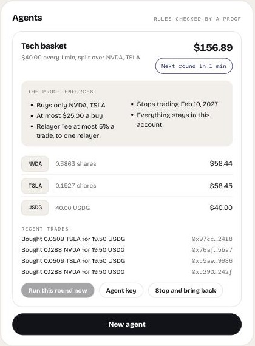
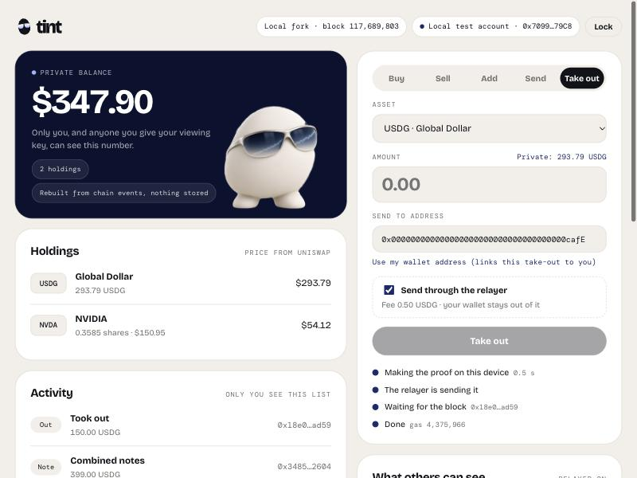

# Tint

**A private AI agent that invests in stocks for you, on Robinhood Chain.**

You set the rules once: which stocks, how much a week, the most per trade, and until when. The agent buys and sells real tokenized stocks inside those rules, and the contracts refuse anything outside them. Nobody watching the chain can see your strategy, what you hold, or that the trades are yours. You see everything, and a viewing key lets an accountant see it too.

Under the agent is a private stock account: USDG and stock tokens in one balance that only you can read. You can also trade from it by hand, send from it and take money out.

**Status:** the private account, the relayer and agents are deployed on **Robinhood Chain testnet** (chain 46630), with verified contracts, and the full agent loop has run there through the relayer ([below](#on-robinhood-chain-testnet)). Testnet uses Robinhood's own test stock tokens, traded on small test pools Tint seeded, with a test USDG. The same code also runs on a local fork of Robinhood mainnet with the real USDG, stocks and pools. Today's agent is auto-invest (a schedule you set, no AI model yet). Nothing is on mainnet yet, and the web app and relayer still run on your machine; see "Not built yet".

Plan: [PLAN.md](PLAN.md). Brand: [brand/BRAND.md](brand/BRAND.md).

## What works today

### Agents

An **agent account** is a private account that only an agent trades from. You create it in the wallet with rules and a plan, and fund it with a private send:

- **Rules, enforced by a zero-knowledge proof** ([circuits/agent_swap](circuits/agent_swap/src/main.nr)): the stocks it may buy (up to five), the most cash per buy, the most it may pay a relayer per trade (5%), the one relayer it may pay, and the date it stops. Everything it buys stays in the account. The rules never go on chain; each trade carries a proof that it follows them, and the pool checks that proof (`agentSwap` in [TintPool.sol](contracts/src/TintPool.sol)).
- **Plan, in code** ([sdk/src/autoinvest.js](sdk/src/autoinvest.js)): how much each round spends, how often, and the slippage. Each round splits the amount evenly over the picked stocks.
- **The agent can't take money out.** Its key only makes `agent_swap` proofs. Moving money out of the account (`agentTransact`) needs a proof made with your spend key **and** the agent key ([circuits/agent_transact](circuits/agent_transact/src/main.nr)). "Stop and bring back" in the wallet does that.
- **No server keeps the agent's state.** The agent key is derived from your wallet signature, the rules ride in an encrypted memo on your own note, and the last round is read from the account's history on chain. A fresh browser finds your agents again from chain events.

The agent runs wherever its key is: the runner ([agent/run.mjs](agent/run.mjs)) runs rounds on schedule, or the wallet runs the due round in the browser ("Run this round now"). Both prove each buy and send it through the relayer.



On the local fork the wallet also offers a 1-minute interval for testing. In one test run the runner made three rounds, a minute apart, each with two relayed `agentSwap` buys (NVDA and TSLA, 19.50 USDG each after the 0.50 fee).

On the fork, the full loop ran with real proofs and real transactions ([sdk/scripts/e2e-agent.mjs](sdk/scripts/e2e-agent.mjs)):
1. A private send funds the agent with 100 USDG.
2. A new wallet finds the agent from chain events.
3. The runner makes one round: two relayed `agentSwap` buys of 20 USDG each, NVDA and TSLA, about 4.54M gas each.
4. A second check finds no round due until next week.
5. The agent key alone is refused when it tries to move money out.
6. Stopping moves USDG, NVDA and TSLA back to the user's private balance, three `agentTransact` sends through the relayer.

**What an agent's rules don't cover:** a holder of the agent key can still make bad trades inside the rules. For example, it can set a loose minimum and lose up to the per-buy cap to price moves or a sandwich on each buy, or trade more often than the plan says. The per-trade cap applies only to buys with cash: a sale (stock to cash, or one listed stock to another) has no size cap and no price floor in the proof, so one bad sale can lose most of what the account holds in that stock. The proof caps what each trade may be, not how good it is. The weekly budget is the plan, not the proof: what the account holds is the most the agent can ever lose.

### Private account

A **web wallet** ([web/](web)) that runs the whole loop on a local fork of Robinhood Chain mainnet, with the real USDG and stock tokens and their real Uniswap pools: add USDG, buy a stock privately, sell it, send to another Tint user, take money out, and open the balance read-only with a viewing key. Every proof is made in the browser in under a second. The same wallet opens on Robinhood Chain testnet ([below](#on-robinhood-chain-testnet)).



**Relayer** ([relayer/](relayer)): the browser makes the proof, and the relayer sends the transaction from its own address and takes a fee ($0.50 by default) out of the private balance, in whatever the action spends. The relayer's address and fee are inside the proof, so it can't change the trade, the recipient or its own pay; it can only send it or refuse. On the fork, a relayed buy, sell, private send and take-out all landed with the relayer as the transaction sender, and the user's wallet appears only on the deposit.

Measured in the browser on the fork (real transactions, receipt gas):

| Action | Proof in browser | Gas |
|---|---|---|
| Add 500 USDG | 0.5 s | 4.42M |
| Buy NVDA with 200 USDG (got 1.3232 NVDA) | 0.5 s | 4.49M |
| Sell 0.6 NVDA (got 90.60 USDG) | 0.4 s | 4.49M |
| Take out 390.60 USDG to a new address (2 notes in) | 0.3 s | 4.37M |
| Send 0.1 NVDA to a Tint address | 0.5 s | 4.33M |
| Buy NVDA with 100 USDG, through the relayer (+0.50 USDG fee) | 0.4 s | 4.55M |
| Agent buy: 20 USDG of NVDA, `agentSwap` through the relayer | 0.1–0.2 s (Node) | 4.54M |
| Agent stop: NVDA back to the user, `agentTransact` through the relayer | — | 4.38M |
| Send 25 USDG privately, through the relayer | 0.4 s | 4.36M |
| Take out 150 USDG, through the relayer | 0.5 s | 4.38M |

At Robinhood Chain's 0.02 gwei, 4.5M gas is about 0.00009 ETH per action.

| Part | Where |
|---|---|
| Note format: owner, commitment, nullifier, Merkle tree (Poseidon2) | [circuits/notes/src/lib.nr](circuits/notes/src/lib.nr) |
| `transact` circuit: 2 notes in, 2 out, for deposit, withdraw and private transfer | [circuits/transact/src/main.nr](circuits/transact/src/main.nr) |
| `swap` circuit: spend notes of one asset, keep the change, reserve a note for what the trade buys | [circuits/swap/src/main.nr](circuits/swap/src/main.nr) |
| Pool: checks proofs, stops double spends, holds tokens, pays a relayer fee | [contracts/src/TintPool.sol](contracts/src/TintPool.sol) (`transact`) |
| Private buy/sell: sells on the Uniswap v3 pool directly, checks the minimum, then finishes the bought note on chain | [contracts/src/TintPool.sol](contracts/src/TintPool.sol) (`swap`, `_sellOnUniswap`) |
| Note tree, depth 20, Poseidon2 on chain | [contracts/src/TintTree.sol](contracts/src/TintTree.sol) |
| `agent_swap` circuit: a trade from an agent account, only inside the rules | [circuits/agent_swap/src/main.nr](circuits/agent_swap/src/main.nr) |
| `agent_transact` circuit: money out of an agent account, needs the spend key and the agent key | [circuits/agent_transact/src/main.nr](circuits/agent_transact/src/main.nr) |
| Pool entry points for agents | [contracts/src/TintPool.sol](contracts/src/TintPool.sol) (`agentSwap`, `agentTransact`, `_agentSwapInputs`) |
| Agent keys, rules hash, account owner, agent key string, encrypted rules memo | [sdk/src/agent.js](sdk/src/agent.js) |
| Auto-invest round: when it is due, what to buy, price, prove, send | [sdk/src/autoinvest.js](sdk/src/autoinvest.js) |
| Agent runner (Node), runs rounds on schedule through the relayer | [agent/run.mjs](agent/run.mjs) |
| Agents panel: create, fund, watch, run a round, copy the agent key, stop | [web/src/Agents.jsx](web/src/Agents.jsx) |
| Proof verifiers generated by `bb` | [contracts/src/verifiers](contracts/src/verifiers) |
| Keys from one wallet signature: spend key, nullifier key, viewing key, `tint1…` address | [sdk/src/keys.js](sdk/src/keys.js) |
| Note encryption (X25519 + ChaCha20-Poly1305), so only the owner can read a note | [sdk/src/encrypt.js](sdk/src/encrypt.js) |
| Wallet engine: rebuilds the private balance and history from pool events, builds each action | [sdk/src/wallet.js](sdk/src/wallet.js) |
| Web wallet: unlock, holdings with Uniswap prices, buy, sell, add, send, take out, viewing key | [web/src](web/src) |
| Relayer: checks the fee and its own address in the proof, simulates, sends one transaction at a time | [relayer/src/server.js](relayer/src/server.js) |
| Deploy script and local fork setup | [contracts/script/Deploy.s.sol](contracts/script/Deploy.s.sol), [tools/dev-fork.sh](tools/dev-fork.sh) |

**What is private today:** balances and holdings (never on chain), who a private send went to and how much, and, with the relayer, who made a buy, sell, send or take-out: the explorer shows the relayer as the sender. **What is not:** adding money always comes from your own wallet, so a deposit shows your address and the amount. Trades show the pair and the size. A relayed private send shows which token paid the fee. The relayer itself sees your IP address and the transaction (never your keys). Taking money out to the same address you deposited from links the two again, so the wallet suggests a new address.

**Not built yet:**
- AI agents: a model that picks within the rules ("model suggests, code decides, proof enforces"). Today's agent follows a fixed plan.
- Selling by plan: agents only buy each round; they can sell under the rules, but no plan sells yet.
- A hosted runner: the runner runs where you start it.
- Hosting: the web app, relayer and runner run on your machine (pointed at testnet or a fork); no public site yet.
- Mainnet: Tint is not deployed on Robinhood Chain mainnet.
- The Stylus tree.

See the phases in PLAN.md.

**Trust model:** the pool owner can list tokens, set deposit caps, pause new deposits and set a swap fee of at most 1% (0 today). The owner can't move anyone's tokens, block withdrawals or touch notes. The code is unaudited, so caps stay low.

## On Robinhood Chain testnet

Deployed Nov 19 2026 with [tools/testnet-deploy.sh](tools/testnet-deploy.sh); addresses in [contracts/deployments/46630.json](contracts/deployments/46630.json). Every contract's source is verified on the [testnet explorer](https://explorer.testnet.chain.robinhood.com).

| Contract | Address |
|---|---|
| TintPool | [`0x8354…dDD3`](https://explorer.testnet.chain.robinhood.com/address/0x83549c518fa3A866d87bbcD4562e26e6B085dDD3) |
| TintTree | [`0xD31c…41cD`](https://explorer.testnet.chain.robinhood.com/address/0xD31cFdD9d9fe4aae0037D56E7fab3c629b1741cD) |
| TransactVerifier · SwapVerifier | [`0xB754…895b`](https://explorer.testnet.chain.robinhood.com/address/0xB754E7738cA69d9af8AC578BCe04C62bC9da895b) · [`0x47d7…5fb6`](https://explorer.testnet.chain.robinhood.com/address/0x47d7eA3864786e2c02f1C4579783B336c9655fb6) |
| AgentSwapVerifier · AgentTransactVerifier | [`0x4Fe1…7292`](https://explorer.testnet.chain.robinhood.com/address/0x4Fe11aA7b4003CecE640EFAF2142A16cFf8e7292) · [`0x4855…61D7`](https://explorer.testnet.chain.robinhood.com/address/0x4855139C35dac6270d97B14b3Ae5D9a0d4A661D7) |
| TestUSDG (tUSDG, open faucet, 1,000 a call) | [`0x2b6B…c35F`](https://explorer.testnet.chain.robinhood.com/address/0x2b6B8F66AaaeFFc4cD51ACbAa5772e9225B9c35F) |

**Test pools.** Testnet has Robinhood's test stock tokens (TSLA, AMZN, AMD, PLTR, NFLX) but no USDG pools, so [SeedTestnet.s.sol](contracts/script/SeedTestnet.s.sol) opens a full-range tUSDG/stock pool for each on the testnet's own Uniswap v3, with the 5 shares of each that the Robinhood faucet gives. TSLA ($382) and AMZN ($266) open at Robinhood Chain mainnet prices from Nov 18; AMD ($240), PLTR ($180) and NFLX ($110) have no mainnet pool, so those prices are set by hand. The pools are tiny, so every trade moves the price; the app labels them "test pool".

**The agent loop on testnet** ([sdk/scripts/e2e-agent.mjs](sdk/scripts/e2e-agent.mjs), Nov 19), real proofs and transactions:

| Step | Sent by | Gas | Tx |
|---|---|---|---|
| Add 300 tUSDG | user's wallet | 4.36M | [0xcb1b2dd8…](https://explorer.testnet.chain.robinhood.com/tx/0xcb1b2dd8322c297279b0dff1955844113fc55d327f458698f4f1925656612156) |
| Fund the agent with 100 tUSDG, private send | relayer | 4.35M | [0x552fc0bb…](https://explorer.testnet.chain.robinhood.com/tx/0x552fc0bbca771305d346cd3b12c786c7f5c84118ac96ba84c0340a9e2fc82b3f) |
| A fresh wallet finds the agent from chain events | — | — | — |
| Runner: buy TSLA with 20 tUSDG (`agentSwap`) | relayer | 4.53M | [0x862f6d6f…](https://explorer.testnet.chain.robinhood.com/tx/0x862f6d6f2ecd2c683d672346e18a23c9511fe60161d344c043f6ac7f1a358d33) |
| Runner: buy AMZN with 20 tUSDG (`agentSwap`) | relayer | 4.52M | [0xe97459be…](https://explorer.testnet.chain.robinhood.com/tx/0xe97459bec2899a97892bfce2ee94f0503602e9cc1d40d8abb870fb202e9a77d3) |
| The agent key alone tries to move money out | — | refused before proving | — |
| Stop: USDG back to the user (`agentTransact`) | relayer | 4.34M | [0xdcf94726…](https://explorer.testnet.chain.robinhood.com/tx/0xdcf9472611cbd634a6d719b0fca482212ffbead704f14076abd05881a00bc6fb) |
| Stop: TSLA back | relayer | 4.38M | [0xf832f484…](https://explorer.testnet.chain.robinhood.com/tx/0xf832f484a5dbcee2bae230ca3ed7b26756998b92885fa13b547b4ba88192c336) |
| Stop: AMZN back | relayer | 4.39M | [0xae4fec63…](https://explorer.testnet.chain.robinhood.com/tx/0xae4fec63875a3ccab61bc030d83a27c1dcd27d4377829ec2560d91fd254f515c) |

The relayer ([`0x5eC4…5652`](https://explorer.testnet.chain.robinhood.com/address/0x5eC4A5b29530b8Bee90A545B91737be64a685652)) paid 0.00027 ETH of testnet gas for its six transactions. The web wallet, opened on testnet with that user's viewing key, rebuilds the same balance and history from the public RPC. Tx hashes for the run are in [evidence/testnet-e2e-agent.json](evidence/testnet-e2e-agent.json).

## Run the wallet locally

```bash
anvil --fork-url https://rpc.mainnet.chain.robinhood.com --chain-id 31337
```

In a second terminal:

```bash
./tools/dev-fork.sh
```

```bash
cd relayer && npm install && npm run dev:fork
```

```bash
cd web && npm install && npm run dev
```

To run an agent on schedule, copy its key from the Agents panel and:

```bash
cd agent && npm install && AGENT_KEY=tintagent1… npm run dev:fork
```

The public RPC only keeps recent state, so after about 10 minutes the fork starts failing reads ("historical state … is not available"). Restart anvil and rerun `dev-fork.sh` when that happens.

Open http://localhost:5180/?chain=31337 (the app opens testnet by default) and choose **Use local test account** (anvil's public dev key, funded with 2,000 fork USDG by `dev-fork.sh`). The relayer uses anvil's account 2. Or connect a browser wallet pointed at `http://127.0.0.1:8545`, chain 31337.

## Run it against testnet

The web app opens Robinhood Chain testnet by default and uses the contracts in `web/src/deployments/46630.json`. You need a browser wallet on chain 46630 (RPC `https://rpc.testnet.chain.robinhood.com`) with a little testnet ETH from the [faucet](https://faucet.testnet.chain.robinhood.com). In the app, **Get 1,000 test USDG** on the Add tab takes tUSDG from its faucet.

A relayer needs its own funded testnet key, as `RELAYER_KEY` in the environment or in `.env.testnet` at the repo root:

```bash
cd relayer && npm install && npm run dev:testnet
```

```bash
cd web && npm install && npm run dev
```

```bash
cd agent && npm install && AGENT_KEY=tintagent1… npm run dev:testnet
```

The deploy itself: `DEPLOYER_KEY=0x… ./tools/testnet-deploy.sh`, with the deployer holding testnet ETH and the faucet's test stocks. `FORK=1` runs the same deploy against a local anvil fork of testnet.

## Build and test

You need nargo 1.0.0 (`noirup`), bb 6.0.0 (`bbup`), Foundry and Node 20+.

```bash
./circuits/build.sh
```

```bash
cd sdk && npm install && npm test
```

```bash
node sdk/scripts/e2e-local.mjs   # full deposit → buy → sell → withdraw on the local fork
```

```bash
node sdk/scripts/e2e-agent.mjs   # fund an agent → runner buys → stop, through the relayer on the local fork
```

```bash
cd contracts && forge test
```

```bash
cd contracts && FORK_TESTS=true forge test --match-contract Fork
```

The Foundry tests call `sdk/scripts/ffi-*.mjs` to make every proof, so `node` must be on your PATH.
